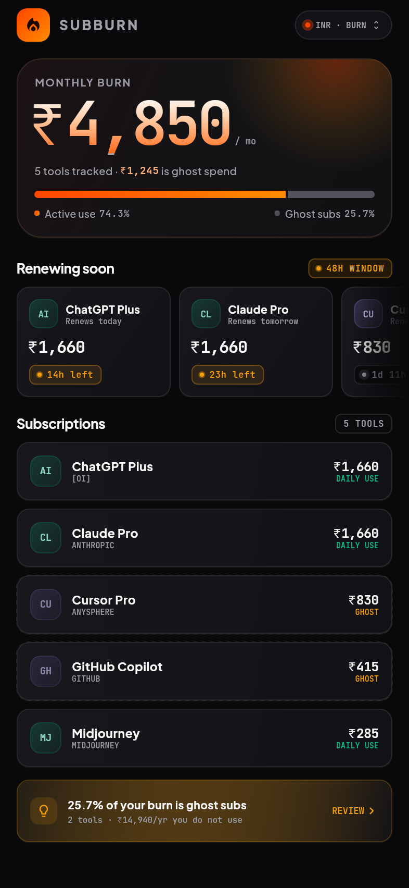
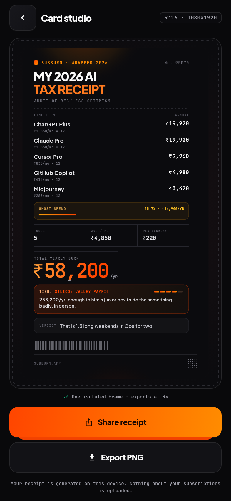
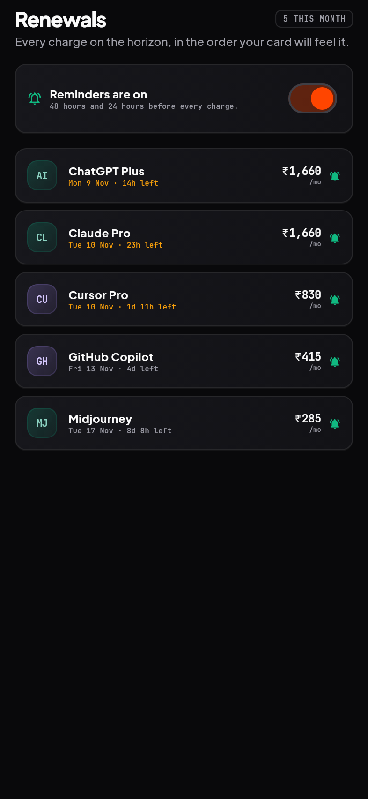

# SubBurn

[](https://github.com/aasheesh333/SubBurn/actions/workflows/build.yml)
[](https://github.com/aasheesh333/SubBurn/actions/workflows/ci.yml)

**An AI & SaaS subscription guilt tracker that turns a year of burn into a
shareable roast receipt.**

Flutter app with **light and dark themes that follow your device** (a manual
choice overrides it). Local-first: every subscription lives in Hive on the
device. No account, no Firestore, no per-user backend cost.

<p align="center">
  
  
  
</p>

---

## What's in this repository

| Path | What it is |
|---|---|
| `flutter/` | **The app.** Riverpod + Hive, 4 screens, 58 tests, no TODOs. |
| `index.html` | Design source of truth — all tokens + 4 frames in CSS |
| `design-tokens.json` | Machine-readable tokens (colour, type, space, semantic rules) |
| `site/` | Public landing page + Play-required privacy policy (InfinityFree + R2 mirror) |
| `HANDOFF.md` | Design rationale, token tables, Figma layer map, export contract |
| `renders/` | Pixel-exact PNGs generated from `index.html` |
| `tools/` | Render, audit, font build, preset generation |
| `figma-plugin/` | Desktop plugin used to build the editable Figma file |

The live Figma file is
**[01 · SubBurn](https://www.figma.com/design/NNx8tBFR3qjmHjGBEsxuu1/01-SubBurn)**
— ~440 editable nodes, not images.

---

## The four screens

1. **Burn Dashboard** — monthly burn hero, active-vs-ghost split bar, 48-hour
   renewal rail with pulsing countdowns, swipe-to-delete subscription list.
2. **Quick Add** — instant local search across 124 presets, 1-tap fill,
   billing cycle, currency, usage guilt, live price chip.
3. **Card Studio** — a 9:16 receipt in a single `RepaintBoundary`; deterministic
   offline roast engine (30 templates, 5 tiers); exports exactly 1080 × 1920.
4. **Renewal & Kill-Switch** — countdown, lifetime spend, reminder toggle,
   and a direct link to the vendor's own cancellation page.

---

## Run it

```bash
cd flutter
flutter pub get
flutter run
```

```bash
flutter analyze     # No issues found
flutter test        # 32/32 passed
```

Regenerate the design artefacts:

```bash
python3 tools/gen_presets.py   # 124 presets -> assets/json + R2 payload
python3 tools/render.py        # board + 4 frames + 1080x1920 receipt
python3 tools/audit.py         # WCAG contrast, tap targets, overflow -> PASS
```

---

## Architecture at a glance

```
lib/
├── main.dart                 boot: Firebase → Hive → seed → Remote Config → runApp
├── app.dart                  MaterialApp, dark only
├── core/
│   ├── theme/theme_tokens.dart   colour, type, space, radius, motion
│   ├── theme/app_theme.dart      Material 3 theme built on google_fonts
│   └── utils/formatters.dart     countdowns, dates, amount parsing
├── data/
│   ├── models/               subscription, billing cycle, usage guilt, currency, presets
│   ├── hive/local_adapters.dart  hand-written adapters (stable field order)
│   └── repositories/         Hive-backed store + first-run seed
├── features/
│   ├── dashboard/            burn_dashboard_screen.dart
│   ├── quick_add/            quick_add_sheet.dart
│   ├── studio/               viral_receipt_screen.dart + roast_engine.dart
│   ├── detail/               sub_detail_screen.dart
│   ├── renewals/             renewals_screen.dart
│   ├── controls/             controls_screen.dart
│   └── shell/                home_shell.dart
├── services/                 catalogue (R2), notifications, analytics, share, OneSignal, Firebase
├── state/providers.dart      Riverpod graph, single burn-summary source of truth
└── widgets/                  receipt, hero, pills, badges, tiles, buttons
```

**One number, one source.** `burnSummaryProvider` computes monthly burn, ghost
share, ghost rupees and the renewal queue once. The hero, the split bar, the
callout and the receipt all read it — so the percentage and the money can never
disagree, which is exactly what v1 got wrong.

---

## Infrastructure — $0, by construction

| Concern | Choice | Why |
|---|---|---|
| User data | **Hive CE**, on device | No reads/writes billed, works offline, private by default |
| Static content | **Cloudflare R2** (`subburn-cdn`) | 10 GB storage + free egress, cached 7 days, bundled fallback |
| FX rate | **open.er-api.com**, cached 24 h | Live USD→INR, with the CDN/bundled rate as fallback |
| Analytics / crashes | **Firebase Spark** | Free tier; only `sub_added` and `roast_card_shared` are logged |
| Remote config | Firebase Remote Config | 12-hour minimum fetch; every key has an in-app default |
| Push | **OneSignal** | Broadcast only, keyed to a random install id |
| Reminders | `flutter_local_notifications` | `inexactAllowWhileIdle` — no `USE_EXACT_ALARM`, no Play special-access form |

The CDN endpoint is served from
`https://pub-8fbd857d2069417ab8436546106f26b3.r2.dev` and can be changed in
Remote Config (`cdn_base_url`) without a release.

---

## Download a build

Every push builds a signed release APK and AAB in parallel:

1. Open the **Actions** tab → **Build** → the run for your commit.
2. Scroll to **Artifacts** and download:
   - `SubBurn-apk-<sha>` → installable arm64 APK
   - `SubBurn-aab-<sha>` → Play Console upload bundle

Artifacts are kept for 30 days. Both are signed with the release keystore; the
APK's certificate SHA-256 matches `docs/PLAY-STORE.md`. If the four keystore
secrets are not configured, the workflow still succeeds with a debug-signed
build and prints a warning.

Repository secrets required for a signed build:

| Secret | Value |
|---|---|
| `KEYSTORE_BASE64` | `base64 -w0 android/keystore/subburn-release.jks` |
| `KEYSTORE_PASSWORD` | keystore password |
| `KEY_PASSWORD` | key password |
| `KEY_ALIAS` | `mykey` |

## Production

Release signing, Play data-safety answers, listing copy and the release flow live
in [`docs/PLAY-STORE.md`](docs/PLAY-STORE.md). The privacy policy is served at

- https://dhanuk.page.gd/SubBurn/privacy.html (canonical)
- https://pub-8fbd857d2069417ab8436546106f26b3.r2.dev/privacy.html (mirror)

The keystore is **not** in this repository. `flutter/android/key.properties` and
`flutter/android/keystore/*.jks` are git-ignored; CI must supply them as secrets.

## Privacy

Subscriptions never leave the device. The CDN requests carry no user data.
Crashlytics receives crash reports only; analytics records two product events
with bucketed values and no names, prices or vendors. Deleting the app deletes
everything SubBurn knows.

---

## Licence

Source is provided for review and handoff. Fonts and brand monograms remain the
property of their owners; no third-party logos are bundled.
